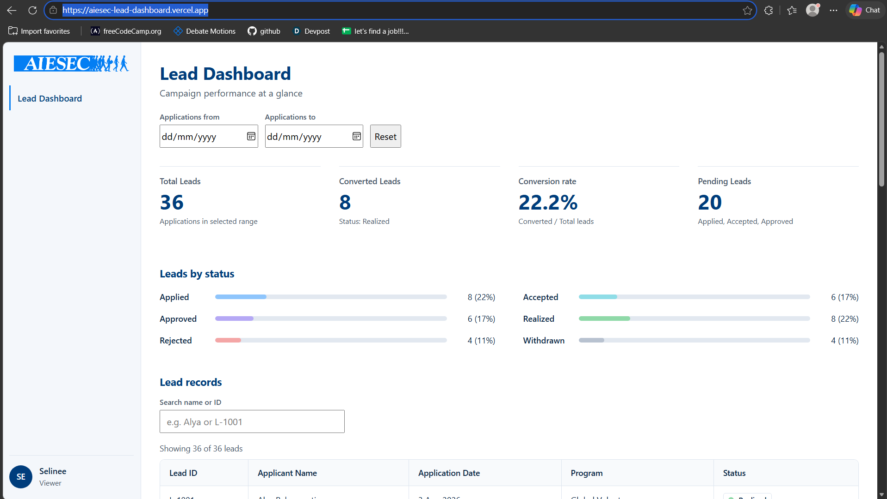

# AIESEC Lead Dashboard

A small dashboard I built for the Web Development Team Lead technical task. It
shows campaign leads, lets you filter them by application date, and works out
how many leads are in each status and what the conversion rate is.

All the data is made up. It isn't connected to EXPA.



**Live link:** https://aiesec-lead-dashboard.vercel.app/ 

## Running it

You need Node.js 18 or newer (I used Node 24).

```
git clone <your-repo-url>
cd aiesec_lead_dashboard
npm install
npm run dev
```

Then open http://localhost:5173.

To try the production build, run `npm run build` and then `npm run preview`.

## How it works

The page only keeps three things in state: the start date, the end date, and
the search text. Everything else is calculated from those every time the page
renders. The date filter produces one list of leads, and the cards and status
bars all use that same list, so the numbers can't disagree with each other.
The table also applies the search, and says "Showing X of Y" so it's clear
when some leads are hidden.

Dates are stored as `YYYY-MM-DD` text and compared as text. I did this to avoid
the timezone bugs you can get from `new Date()`.

## Conversion rate

Conversion rate = Realized leads / all leads in the selected date range x 100.

I treated "Realized" as converted and counted every lead in the range as the
total, including rejected and withdrawn ones. That's my assumption, and it
should be checked against the real campaign rules. If there are no leads in
the range it shows 0% instead of NaN.

## Updating it

**Leads:** edit `src/data/mockLeads.js`. Each lead has an id, a name, an
application date (`YYYY-MM-DD`), a program, and a status. The status has to
match one of the keys in `statusConfig.js` (like `realized`), otherwise the
lead won't be counted.

**Statuses:** edit `STATUSES` in `src/data/statusConfig.js`. If you add, rename,
or remove one, the status bars and the table badges update on their own.

**What counts as converted or pending:** `CONVERTED_STATUS` and
`PENDING_STATUSES`, in the same file.

**The conversion formula:** `calculateConversionRate` in `src/utils/leadMetrics.js`.

**Colors:** the CSS variables at the top of `src/index.css`.

The AIESEC logo belongs to AIESEC. I'm only using it for this prototype. The
colors are my own guess at the palette, not an official spec.

## Connecting it to EXPA

Not built yet. How I'd approach it (architecture, API key handling, and what
could go wrong with thousands of leads) is in my presentation.